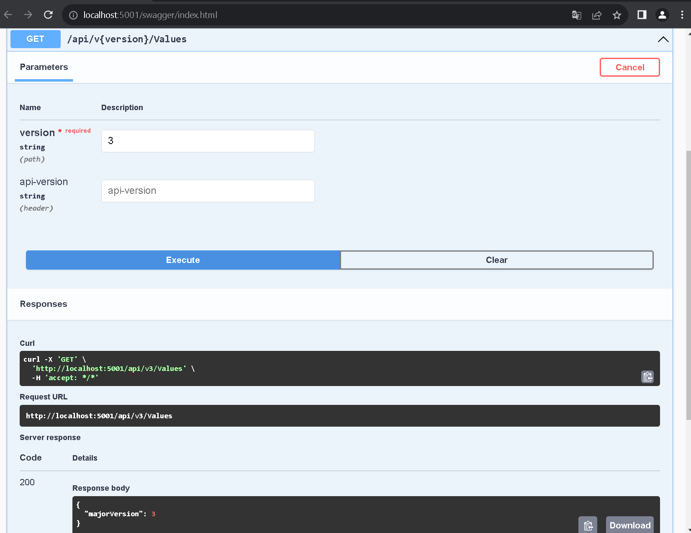

## Test

### El objetivo es mantener un versionado de las api, para ser reutilizado de una forma fácil y rápida.

* Seleccionar el proyecto "Tests.Api.Versioning".

* Configurar los servicios ApiVersioning:

```cs
services.LoadApiVersioning(options => {});

application.LoadApiVersioning();
```

* Iniciar la api con algunos de los perfiles: DefaultVersion, v1, v2. v3.

* Ej. poniendo como versión 3:

