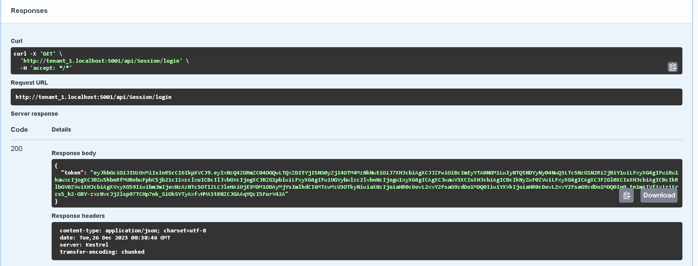

## Test ApiSession

### El objetivo es guardar en sesión los datos mas relevantes del usuario y/o tenant para consultar sus datos desde cualquier parte de la app.

* Buscar el archivo "applicationhost.config" en la carpeta "template-netcore-api\.vs\Solution\config\".

* Buscar la palabra "localhost" en el archivo "applicationhost.config".

* Agregar los tenants que sean necesarios:

```xml
<site name="Tests.Api.AppSession" id="2">
    <application path="/" applicationPool="Tests.Api.AppSession AppPool">
        <virtualDirectory path="/" physicalPath="D:\SFERRARI\01 - TRABAJO\repos\netcore\libs\template-netcore-api\tests\Tests.Api.AppSession" />
    </application>
    <bindings>
        <binding protocol="https" bindingInformation="*:44357:master.localhost" />
        <binding protocol="https" bindingInformation="*:44357:tenant_1.localhost" />
        <binding protocol="https" bindingInformation="*:44357:tenant_2.localhost" />        
    </bindings>
</site>
```

* Agregar el servicio de "LoadSession()" cargar las opciones desde el appsettings o manualmente.

* Agregar el middlware de "LoadSession()".

* Iniciar la api con el perfil "Master" o "Tenant_1" o "Tenant_2".

* Obtener el token ejecutando el endpoint "api/session/login".
* 


* Copiar el token en  Authorization Bearer.

* Obtner los valores de session ejecutando el endpoint "api/session/data".


